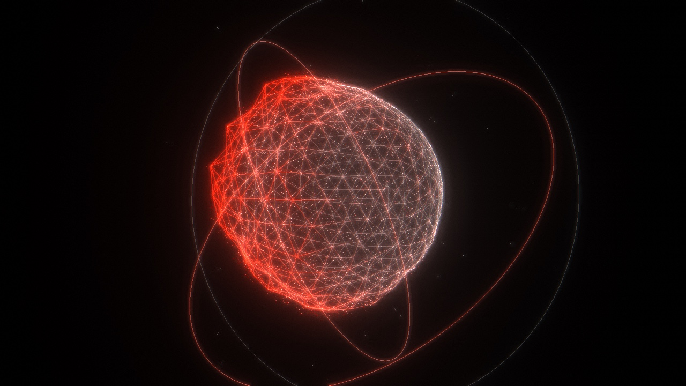

# ms-vis

An audio-reactive visualizer for the Elektron Model:Samples in a single HTML file. Built with Three.js and the native Web MIDI API, in the aesthetic of Keijiro Takahashi: black background, procedural geometry, monochrome palette with rare orange accents (`#FF5500`).

**Live demo:** https://kirillrybin.github.io/ms-vis/

Open the demo with `?demo` (https://kirillrybin.github.io/ms-vis/?demo) to start the simulated beat automatically with a clean UI.

## Getting started

1. Open the live demo in Google Chrome, or run a local server with `python3 -m http.server 8000` in the project folder and open http://localhost:8000. Opening `index.html` via `file://` also works, but Chrome does not remember the microphone permission there, so you have to grant it again on every load.
2. Allow MIDI access.
3. The visualizer connects to the first available MIDI input (it prefers devices with "Model" or "Elektron" in the name). You can switch the device in the selector in the top-left corner. It fades out after 3 seconds and reappears on hover.

The first visit needs an internet connection: Three.js r160 and its addons are loaded from a CDN (jsdelivr). After that the page works **offline**: a service worker (`sw.js`) keeps the page and every library file in the browser cache, so a flaky Wi-Fi at a gig cannot break it. The *Performance* group of the settings panel shows `Offline: ready` once everything is cached. Open the page once online before you go on stage. It works over https (the live demo) or `localhost`, not over `file://`. The page is always fetched from the network first, so updates arrive on the next load; if the network does not answer within 3 seconds, the cached copy is used. The page can also be installed as an app from the browser menu (*Install ms-vis*).

No synth at hand? Press the hidden **Test Beat** button in the bottom-right corner (it appears on hover). It plays a simulated groove through the same handlers as real MIDI. There are five grooves to choose from in the *Test beat* group of the settings panel: House (122 BPM), Breakbeat (132), Half-time (80), Drum & bass (174) and Ambient (90). Changing the groove while it plays switches to the new one at once.

## Setting up the Model:Samples

Out of the box the Model:Samples may send nothing useful over USB (in the first tests only the clock came through, no encoders and no Program Change). Set these in the **CONFIG** menu:

| Menu | Setting | Value | What it enables |
|------|---------|-------|-----------------|
| **MIDI → SYNC** | CLK OUT | **ON** | MIDI clock, Start and Stop (tempo and the beat pulse) |
| **MIDI → SYNC** | PCH OUT | **ON** | Program Change when you switch patterns (preset slots) |
| **MIDI → PORTS** | OUT TO | **M+U** | send to both the MIDI port and USB (the visualizer needs USB) |
| **MIDI → FILTER** | ENCS | **I+E** | encoder turns are sent as CC (Bloom, Cutoff, Sharpness and the other mapped knobs) |

Then connect the device with a USB cable, open the page and allow MIDI access. The Model:Samples should be picked automatically; otherwise choose it in the selector in the top-left corner.

To check what arrives, open the settings panel (**H**), the *MIDI & clock* group:

- the line under the title shows the listened port and counters: `messages` counts notes and CCs, `clock/realtime` counts the clock;
- the MIDI log lists the latest messages by channel: notes as `ch1 note 60 vel 100`, encoders as `ch1 CC 74 = 80`, a pattern change as `ch8 program 2` (Program Change may come on a different channel than the tracks; the visualizer accepts it from any channel).

To see the raw MIDI text outside the browser, you can use **MIDI Monitor** by Snoize (a free macOS app, https://www.snoize.com/midimonitor/): select the Model:Samples as its source and it lists every message the device sends, with the channel and the values. It is handy to tell whether a problem is on the device side (nothing is sent) or in the page.

If something is missing:

| Symptom | Check |
|---------|-------|
| Nothing arrives at all | the right port is selected, no other program (a DAW, Elektron Transfer) holds the device, MIDI access is allowed in Chrome |
| Only the clock arrives (`clock/realtime` grows, `messages` stays 0) | the track channels and the notes themselves: play a pad or run a pattern; for knobs set **FILTER → ENCS** as above |
| Knobs do nothing | **ENCS = I+E**; then turn a knob and look for its `CC` number in the log, and bind it with **Learn** if it is not the default one |
| Pattern change does not switch the look | **PCH OUT = ON**, presets saved into the slots (Shift + 1–5), and see *Program Change* below to bind the program numbers |

## Projector mode

| Key | Action |
|-----|--------|
| **F** | Fullscreen. All UI is hidden, only the picture remains |
| **R** | Start / stop video recording. A `.webm` file is downloaded when you stop |
| **T** | Toggle Test Beat when the button is hidden |
| **1–5** | Load a settings preset |
| **Shift + 1–5** | Save the current settings (including the accent color) into that slot |
| **H** | Show / hide the settings panel |
| **?** | Show this list of keys in the app (**Esc** or a click outside closes it; not available in fullscreen) |

The cursor disappears after 2 seconds without mouse movement. While recording, a small orange dot blinks at the top center. Audio is included in the recording if you pick an audio input in the settings panel (**H**, *Recording* group). The Model:Samples shows up there as a USB audio device. Choose the input before you start recording; Chrome will ask for microphone permission. By default the recording is silent.

## Settings

Press **H** to show or hide the panel in the top-right corner. The five preset slots are always at the top; everything else is in collapsible groups (the open or closed state of each group is remembered):

- **Reaction:** kick and snare sensitivity and decay speed, camera zoom on kick, maximum RGB shift on snare, number of hi-hat particles, strength of the note ripple;
- **Look:** the core shape (see below), bloom base level and range, particle density, size and brightness, hi-hat trails, film grain, rotation speed, and the accent color (a color picker plus six swatches that recolor the rare particles, ripple rings, hi-hat sparks, rings, scanner band and the UI);
- **MIDI & clock:** strength of the clock beat pulse and scanner band, the last MIDI message, connection diagnostics and CC learn;
- **Performance:** idle calm (after the chosen number of seconds without MIDI the scene gently calms down: smoother shape, softer glow, slower rotation; it wakes up instantly on the next message) auto quality, and **Preset blend**: how many seconds a preset change takes (0.6 s by default, 0 = instant);
- **Test beat:** the groove played by Test Beat;
- **Recording:** the audio input used for video recording;
- **Backup:** export and import of your whole setup (see below).

When you load a preset (keys **1–5**, a click on a slot or a Program Change from the synth) the sliders and the accent color glide to the new values over the blend time instead of jumping; the shape, groove and shape parameters switch at once (the shape has its own half-second transition). Moving a slider by hand while the glide runs takes that slider out of it. The blend time is stored apart from the presets and is part of the settings export.

Values are saved in the browser's `localStorage`. **Reset all settings** at the bottom restores the defaults. To use a preset slot, click it (or press **1–5**) to load it, Shift+click (or **Shift+1–5**) to save the current settings into it.

### Backup

Everything is stored in the browser's `localStorage`, so it lives in one browser on one computer. The *Backup* group of the settings panel moves it around:

- **Export settings** downloads `ms-vis-settings-<date>.json` with the current look settings, the five preset slots (shapes included), the CC mapping, the track roles and the Program Change option and map;
- **Import settings…** reads such a file back. Presets in the file replace the slots with the same number; slots that are not in the file stay as they are. The panel tells you what was imported.

The importer only accepts files that were made by this app (`"format": "ms-vis-settings"`), refuses files over 200 KB and checks every value: numbers are clamped to the range of their slider, colors, shapes, grooves and roles must be known values, CC numbers must be integers from 0 to 127, and anything unknown is ignored. A broken or hostile file cannot put the app into a bad state, it can only fail with a message.

## Shapes

The core can take six shapes: **Sphere**, **Torus**, **Cube**, **Knot**, **Disc** and the **Teapot** (the Utah teapot, the classic test model of 3D graphics, built from Three.js's `TeapotGeometry`). Pick one in the *Look* group of the settings panel. Every shape is a cloud of particles plus a wireframe, and all of them go through the same noise deformation and react to the same notes, CCs and clock. When you change the shape, the core collapses, swaps at the smallest size and blooms back (half a second).

The shape is part of a preset, like the colors and the sliders. So a Program Change from the synth, a preset key (**1–5**) or a click on a preset slot changes the whole form of the visuals, not only the tint: save a different shape into each slot and the look follows the pattern you play.

### Shape parameters

Under the shape selector in the *Look* group, the sliders of the selected shape appear (the others stay hidden). Changing a slider rebuilds only that shape, a fraction of a second after you stop moving it. The values are saved in presets and in the settings export like the other sliders.

| Shape | Parameters |
|-------|------------|
| Torus | radius (0.4–1.0), tube thickness (0.08–0.5) |
| Knot | windings P and Q (1–7, whole numbers), tube thickness (0.08–0.35) |
| Cube | size (0.8–1.8) |
| Disc | thickness (0.05–0.6) |

Sphere and Teapot have no parameters. A shape that would grow past the view is scaled down to fit.

### Video background

The *Look* group has a **Video background** row with three sources: **File…** (a local `.mp4` or `.webm`, looped and muted), **Camera** and **Screen** (a shared screen or window, for example the output of another VJ program). The picture is cropped to cover the screen and plays behind the core. It is added to the picture right after the bloom (a bright full-screen picture would otherwise be amplified by the bloom several times), so the RGB shift, snare inversion and grain apply to it and it is part of the recording (**R**). **Video opacity** (0.3 by default) dims it so that the particles stay readable; it is a normal slider, so it is saved in presets and glides between them. A snare hit inverts the video together with the rest of the picture. **Remove** stops the source.

Nothing is uploaded and the video is not saved: pick it again after a reload. Camera and screen need the browser's permission. A 1080p video is a good size; 4K together with the bloom can cost frames.

### Your own model

**Load model…** in the *Look* group turns an `.obj`, `.stl` or `.glb` file into a seventh shape, **Custom**. All meshes in the file are merged, centred and scaled to the same size as the other shapes, then sampled into the particle cloud. The file is only parsed as data: it may be up to 20 MB and 300,000 triangles, and a `.glb` must have its buffers embedded (textures and materials are ignored). Models over 15,000 triangles draw their wireframe as a random sample of the edges, to keep the frame rate up. **Remove** drops the model and returns to the sphere.

The model is kept in this browser (IndexedDB), so it is still there after a reload. It is not part of the settings export, and a preset that uses Custom shows the sphere on a computer where no model is loaded yet.

## MIDI mapping

Channels 1–6 are used, which are the Model:Samples tracks by default. The table below shows the default roles; each channel can be given any other role (see *Track roles* below).

| Channel | Role | Reaction |
|---------|------|----------|
| 1 | Kick | Geometry expansion pulse, light camera zoom with smooth decay |
| 2 | Snare | Chromatic aberration (RGB Shift) and color inversion for 100 ms |
| 3 | Hi-Hat | Burst of small particles around the center |
| 4–6 | Rings | Rotation and pulsing of thin wireframe rings, driven by the note number |

Note On velocity is taken into account. Every note also sends a ripple across the core: a thin, clean ring of light that expands from the channel's own origin on the side facing you (kick lower left, snare upper right, hi-hat upper left, channel 4 lower right, channels 5 and 6 at the sides), tints the surface orange as it passes and fades out. It hardly changes the shape of the sphere. The note's pitch nudges the origin, so tracks look different even when they play the same note. Note Off lets a ring (channels 4–6) fade out as soon as the key is released, otherwise it is held for up to 1.5 s. Pitch Bend on any of channels 1–6 rolls the camera.

| CC | Parameter | Effect |
|----|-----------|--------|
| 74 | Filter Cutoff | Noise frequency and amplitude: from a smooth sphere (0) to a chaotic hedgehog (127) |
| 12, 13 | Delay / Reverb | Bloom intensity |
| 71 | Resonance | Sharpness of the shape: low values soften the spikes, high values make the surface craggy and add spikes even on a smooth sphere |
| 7 | Volume | Brightness: full volume is the normal look, lower values dim the scene |
| — | (unassigned) | *Particle size* and *Rotation*: bind any knob with **Learn** |

CC messages are accepted from any of channels 1–6. These are the defaults, every row can be rebound to any CC (see below). A knob can drive only one thing: binding a CC that is already used moves it.

### Track roles

In the *MIDI & clock* group of the settings panel, *Track roles* lets you decide what each MIDI channel does, so the visuals match how your tracks are really used:

- **Kick**, **Snare**, **Hi-hat**: the reactions described above;
- **Ring 1**, **Ring 2**, **Ring 3**: pulse and spin one of the three wireframe rings, driven by the note;
- **Ignore**: notes on that channel do nothing (not even the ripple of light).

Several channels may share a role, for example two kick tracks. Every channel that is not ignored also sends its own ripple across the core, whatever its role is. **Default roles** restores the table above. The roles are stored apart from the presets, like the CC mapping and the Program Change option, so loading a preset never changes them. Test Beat plays on channels 1–6 and follows the roles too.

### Program Change

A Program Change message switches the look to a preset slot, so the visuals can follow the pattern or project you play on the synth. It works on any channel. By default the program number picks the slot and repeats: 0 → slot 1, 1 → slot 2, … 4 → slot 5, 5 → slot 1, and so on.

To choose the numbers yourself, use the **Slot 1–5** rows under the checkbox in the *MIDI & clock* group: press **Learn** next to a slot, then change a pattern on the synth, and the program it sends is bound to that slot (a program belongs to one slot; **×** unassigns a slot, **Clear map** empties the table). Once at least one program is mapped, every program that is not in the table is ignored; with an empty table the default repeating mode is back. The map is stored apart from the presets and is included in the settings export. If the slot is empty nothing changes and the status line says so. Save your looks into the slots first (Shift+**1–5**).

The checkbox in the *MIDI & clock* group turns this off (it is on by default). The setting is stored apart from the presets, so loading a preset never changes it. To see what your device sends when you change a pattern, look at the MIDI log in the same group: a Program Change shows up as `ch1 program 3`. If nothing appears, check the device's MIDI settings for sending Program Change.

### MIDI clock

When the device sends MIDI clock, the visualizer follows the tempo:

- **Scanner band:** a glowing great circle sweeps around the core once per bar, like a scanner hoop. It stands vertical on the downbeat, swings through every angle during the bar and is back at the start on the next downbeat. A short tail behind it shows the direction. The band lights up the particles and the wireframe in the accent color and fades in only while clock is arriving, so if you see it, the sync works;
- the tempo is measured from the clock (24 pulses per quarter note) and shown in the diagnostics line of the panel;
- every beat gives the core a pulse (about 9% bigger) and extra glow;
- every downbeat (first beat of a bar) gives a stronger pulse and lights up the next ring in turn;
- the rotation speed scales with the tempo (120 BPM is the reference speed);
- **Start** resets the count to the first beat of the first bar, **Stop** freezes it, **Continue** resumes it and **Song Position** realigns the bar. If the page is opened while the sequencer is already running, the beats are counted from the moment the page started receiving clock until the next Start or Song Position, so the downbeat may be off;
- a running sequencer also keeps the scene awake, so the idle calm does not kick in during playback.

The *Clock beat pulse* slider sets the strength of the pulse and of the scanner band (0 turns both off). Test Beat is a real clock source (the tempo of the chosen groove) and drives the same pulse, so you can see how it works without a synth. On Elektron devices, enable clock output in the MIDI sync settings of the device if the *clock/realtime* counter in the panel stays at 0.

### Checking and remapping CCs

Open the settings panel (**H**) and the *MIDI & clock* group. It starts with a MIDI log: the six latest messages, newest on top, for example `ch2 CC 74 = 100`. The log includes messages that are not mapped to anything and notes from channels above 6 (marked `· ignored`). A message of the same kind (same channel, type and number) updates its own line instead of adding a new one, so a knob sweep or a note-on and note-off pair never floods the list, and the box has a fixed height, so the panel does not jump. Under it, a status line lists the MIDI inputs found, the one(s) being listened to and two counters: *messages* (notes, CC, pitch bend) and *clock/realtime* (MIDI clock and similar). Use them to find where the signal stops:

- *clock/realtime* grows but *messages* does not move when you turn a knob or play a pad: the device is connected but is not sending those messages. Check its MIDI output settings (for example which parameters or which port it sends to).
- both counters stay at 0: nothing reaches the browser from the selected input. Pick another input, or choose **All inputs** in the selector in the top-left corner (it appears when more than one input exists), and check the cable, the USB connection and the device's MIDI port settings.
- *messages* grows but nothing happens on screen: the message is probably on a channel above 6 or a CC that is not mapped, see the MIDI log above. Some Elektron devices can send parameter changes as NRPN instead of plain CC, which this visualizer does not read.

If the knob appears with a different CC number than the defaults, press **Learn** next to the parameter (*Cutoff*, *Bloom*, *Sharpness*, *Brightness*, *Particle size* or *Rotation*), then turn the knob on the device. That CC is bound immediately and remembered; **×** unassigns it. **Default CCs** restores the table above. The mapping is stored separately from the presets, so loading a preset never changes it.

## Under the hood

- **Core:** 36,000 particles (`Points`) plus a wireframe (`LineSegments`) for each of the six shapes. The sphere uses a Fibonacci distribution and an icosphere, the other shapes sample random points on the surface of a Three.js geometry. Only the selected shape is drawn. All of them are deformed in the vertex shader by 3D simplex noise.
- **Hi-hats:** a pool of 900 particles whose motion is computed entirely in the vertex shader. The CPU only writes spawn data when a hat is hit.
- **Ripples:** up to six rings (one per channel) are evaluated in the vertex shader. They show mostly as light and color, not as geometry. A ring costs nothing while it is inactive.
- **Trails:** every hi-hat particle is drawn as a head plus 4 fading samples, all computed in the shader from the same spawn data.
- **Film grain:** a final full-screen pass adds subtle noise, strongest in the mid-tones, and leaves pure black clean.
- **Auto quality:** if FPS stays below 45, particle density is lowered (and, as a last resort, the pixel ratio drops to 1); it recovers slowly when FPS is stable. The current FPS and quality level are shown in the settings panel title. It can be switched off with the "Auto quality" slider (Performance group).
- **Post-processing:** `EffectComposer` with `UnrealBloomPass`, `RGBShiftShader` and a custom inversion pass.
- **All code** (HTML, CSS, JS, GLSL) lives in a single `index.html` file; `sw.js`, `manifest.webmanifest` and `icon.svg` only add offline use and installation.

## License

[MIT](LICENSE) © 2026 Kirill Rybin
